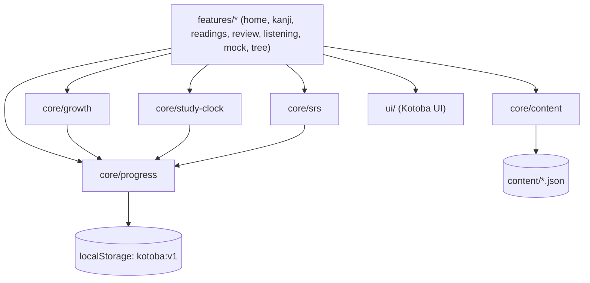
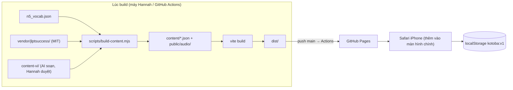

# Architecture Spine: Kotoba

## Design Paradigm

Kotoba là **web app tĩnh, kiến trúc phân tầng**. Không có server và không có tài khoản. Nội dung là file JSON chỉ đọc, còn tiến độ học nằm trong trình duyệt.

| Tầng | Thư mục | Làm gì |
| --- | --- | --- |
| Nội dung | `content/` (dữ liệu), `src/core/content.js` (cửa đọc) | JSON đã gom sẵn, chỉ đọc |
| Lõi | `src/core/` | `progress` (lưu trữ), `srs` (lịch ôn), `study-clock` (đếm giờ học), `growth` (luật dẫn xuất), `router` |
| Tính năng | `src/features/<tên>/` | home, kanji, readings, review, listening, mock, tree |
| Giao diện | `src/ui/` | Kotoba UI (tokens, components, Pyon) |

## Invariants & Rules



### AD-1: Stack: Vite + JavaScript thuần, không framework [ADOPTED]

- **Binds:** all
- **Prevents:** mỗi story tự kéo vào framework hay thư viện giao diện riêng, hoặc viết lại Kotoba UI.
- **Rule:** dùng JavaScript thuần với ES modules và build bằng Vite. Không React, Vue hay Svelte. Không service worker, vì app chạy online (NFR-1). Giao diện chỉ dùng Kotoba UI ở `src/ui/` (tokens, `bundle.css`, `bundle.js`, `Kotoba.hydrate()`). Muốn thêm thư viện runtime ngoài `ts-fsrs` thì phải ghi thành một AD mới.

### AD-2: Ranh giới tầng và hướng phụ thuộc [ADOPTED]

- **Binds:** all
- **Prevents:** các tính năng dính chặt vào nhau, sửa story này làm hỏng story khác.
- **Rule:** phụ thuộc chỉ đi theo sơ đồ trên. Một `features/<x>` **không được import** `features/<y>`. Khi cần tác động chéo, ví dụ thi thử đưa câu sai vào lịch ôn, thì phải ghi qua `core/progress`. `core/*` không được import `features/*`.

### AD-3: Nội dung là bộ JSON riêng của Kotoba, gom lúc build [ADOPTED]

- **Binds:** FR-1 đến FR-5, FR-8, FR-14 đến FR-18, NFR-2, NFR-5
- **Prevents:** mỗi tính năng tự đọc một kiểu dữ liệu nguồn khác nhau (n5_vocab, JLPTSuccess), và app hỏng khi repo nguồn thay đổi.
- **Rule:**
  - Chỉ `scripts/build-content.mjs` được đọc dữ liệu nguồn: `n5_vocab.json`, `vendor/jlptsuccess/` và `content-vi/`. Script này xuất ra `content/*.json` theo đúng schema trong `content/SCHEMA.md`.
  - Lúc chạy, app chỉ đọc nội dung qua `core/content`.
  - Không sửa tay file trong `content/`. Phần tiếng Việt do AI soạn nằm ở `content-vi/`, mỗi mục có `reviewStatus: "draft" | "approved"`.

### AD-4: Một kho tiến độ duy nhất [ADOPTED]

- **Binds:** FR-6, FR-7, FR-9 đến FR-13, FR-18, FR-19, NFR-3
- **Prevents:** hai tính năng lưu cùng một thứ (thời gian học, trạng thái thẻ) theo hai cách khác nhau, ví dụ cây lớn sai hoặc lịch ôn bị ghi đè.
- **Rule:**
  - Chỉ `core/progress` được gọi `localStorage`, dưới một khoá duy nhất `kotoba:v1`.
  - Tính năng đọc và ghi qua API của `progress`. Mỗi thay đổi phát sự kiện `progress:changed`.
  - Dữ liệu có `schemaVersion`. Khi đổi cấu trúc phải viết hàm chuyển đổi, để file sao lưu cũ vẫn nhập lại được.
  - Xuất và nhập sao lưu là một file JSON chứa toàn bộ dữ liệu của `kotoba:v1`.

### AD-5: Một đồng hồ học duy nhất tính thời gian học thực

- **Binds:** FR-9, FR-10, FR-11, FR-12, SM-2
- **Prevents:** mỗi màn hình tự đếm giờ, gây đếm trùng hoặc đếm cả lúc để app mở mà không làm gì.
- **Rule:**
  - Chỉ `core/study-clock` đếm thời gian học thực. Tính năng chỉ gọi `studyClock.activity()` khi có tương tác: trả lời, lật thẻ, phát audio.
  - Quá 60 giây không có tương tác thì dừng đếm.
  - Đồng hồ ghi số giây đã học vào `progress` theo từng ngày (`YYYY-MM-DD` theo giờ trên máy).
  - Độ cao và mức héo của cây **được tính ra từ** lịch sử thời gian học này. Cây không lưu một bộ đếm riêng.

### AD-6: Lịch ôn dùng FSRS qua một lớp bọc duy nhất [ADOPTED]

- **Binds:** FR-3, FR-5, FR-7, FR-8, FR-18
- **Prevents:** mỗi loại thẻ dùng một thuật toán hay một cách chấm điểm riêng.
- **Rule:**
  - Mọi thẻ (kanji, từ vựng, cách đọc, câu thi sai) được lên lịch bằng `core/srs`, là lớp bọc quanh `ts-fsrs`.
  - Mã thẻ có dạng `<loại>:<id nội dung>`, ví dụ `kanji-nghia:日`, `kanji-doc:日`, `kanji-chu:日`, `vocab:n5-0002`, `reading:day-01`, `mock:<question id>`. Mỗi kanji có 3 thẻ theo 3 chiều ôn.
  - Trạng thái thẻ lưu trong `progress`.

### AD-7: Thêm vào màn hình chính iPhone và nhắc sao lưu [ADOPTED]

- **Binds:** NFR-1, NFR-3
- **Prevents:** Safari trên iPhone xoá toàn bộ tiến độ sau 7 ngày không mở trang.
- **Rule:**
  - App có `manifest.webmanifest` và icon để thêm được vào màn hình chính.
  - Khi phát hiện đang chạy trong tab Safari thường, không phải mở từ màn hình chính, app hiện hướng dẫn thêm vào màn hình chính.
  - `progress` lưu ngày sao lưu gần nhất. Trang chủ nhắc xuất sao lưu khi đã quá 7 ngày chưa sao lưu.

### AD-8: Luật dẫn xuất ở core, hiển thị dùng chung ở ui

- **Binds:** FR-6, FR-9 đến FR-13, FR-3, FR-8, FR-18
- **Prevents:** trang chủ và màn hình cây tính độ cao hoặc mức héo khác nhau. Ôn tập và Kanji vẽ cùng một loại thẻ theo hai kiểu.
- **Rule:**
  - Mọi giá trị dẫn xuất dùng ở nhiều màn hình đều được tính trong `core/growth`, là hàm thuần, có test. Gồm: độ cao cây, mức héo, số ngày đã bỏ học, số thẻ đến hạn hôm nay, đếm ngược tới ngày thi.
  - Thành phần hiển thị dùng ở nhiều tính năng nằm ở `src/ui/`: `ui/tree-view`, và `ui/cards/<loại>` cho kanji, vocab, reading, mock.
  - Tính năng chỉ được ghép các thành phần này lại, không tự viết lại.

### AD-9: Giao diện bám đúng thiết kế Kotoba UI [ADOPTED]

- **Binds:** mọi story có giao diện; NFR-4
- **Prevents:** mỗi story tự chế màu, font, khoảng cách hay component, khiến app lệch khỏi thiết kế của Hannah.
- **Rule:**
  - `kotoba-design/design/kotoba-ui/` là nguồn chuẩn duy nhất về giao diện: `README.md` (nguyên tắc), `tokens.json`/`tokens.css`, và `components/<Tên>/README.md` + `preview.html`.
  - Màu, font, cỡ chữ, khoảng cách, bo góc, bóng chỉ được lấy qua biến CSS trong `tokens.css`. Cấm ghi cứng mã màu hay giá trị px ngoài token.
  - Màn hình được ghép từ component có sẵn, dùng đúng markup và class trong `preview.html` của component đó. Component mới (`ui/tree-view`, `ui/cards/*`, thẻ cách đọc) phải tuân theo 5 nguyên tắc trong README và chỉ dùng token sẵn có.
  - Giữ nguyên các quy tắc của thiết kế: một Pyon mỗi màn hình, đúng biểu cảm theo ngữ cảnh; một khối `surface-tint` mỗi màn hình; nút luôn dùng nấc đậm (`primary-strong`, `blue-strong`); "Ôn lại" màu trung tính, không đỏ; màu kỹ năng cố định (Kanji `skill-kanji`, từ vựng `skill-vocab`, nghe `skill-speaking`); chữ Nhật dùng `kt-jp` + `lang="ja"`.
  - Mỗi story giao diện phải được đối chiếu với `preview.html` của các component nó dùng trước khi coi là xong.

## Consistency Conventions

| Concern | Convention |
| --- | --- |
| Đặt tên | File và thư mục viết `kebab-case`, hàm viết `camelCase`. Mỗi tính năng có `features/<tên>/index.js` xuất `mount(el, params)` |
| Điều hướng | Dùng hash route `#/<tính năng>/<tham số>`, ví dụ `#/kanji/日`, `#/mock/3`. Chỉ `core/router` định nghĩa route |
| ID nội dung | Kanji: chính chữ đó (`日`). Từ vựng: id có sẵn `n5-0001`. Câu hỏi và bài nghe: giữ id của JLPTSuccess. Cách đọc: `<nhóm>-<số>` |
| Ngày giờ | Lưu thời điểm dạng ISO 8601, ngày học dạng `YYYY-MM-DD` theo giờ trên máy |
| Ngôn ngữ | Mọi chữ hiển thị viết tiếng Việt, đặt ngay trong tính năng. Không làm đa ngôn ngữ (i18n) |
| Lỗi | Lỗi đọc nội dung hoặc tiến độ hiện một thông báo tiếng Việt bằng component EmptyState. Không được làm trắng màn hình |
| Ghi công | Trang "Giới thiệu" và `NOTICES.md` ghi công JLPTSuccess (MIT), KanjiVG (CC BY-SA 3.0), VOICEVOX |

## Stack

| Name | Version |
| --- | --- |
| Vite | 8.3.8 |
| JavaScript (ES modules) | ES2022 |
| ts-fsrs | 6.0.0 |
| Vitest | 5.1.0 |
| GitHub Pages + GitHub Actions | dịch vụ hiện hành |

## Structural Seed



```text
japanesestudy/
  content/            # JSON nội dung đã gom (sinh tự động) + SCHEMA.md
  content-vi/         # phần tiếng Việt do AI soạn, có reviewStatus
  vendor/jlptsuccess/ # bản sao dữ liệu N5 cần dùng + LICENSE
  public/audio/       # audio bài nghe + cách đọc kanji (~360 file)
  scripts/            # build-content.mjs
  src/
    core/             # content, progress, srs, study-clock, growth, router
    features/         # home, kanji, readings, review, listening, mock, tree
    ui/               # Kotoba UI (chép từ kotoba-design/design/kotoba-ui) + tree-view, cards/
    main.js
  kotoba-design/      # nguồn thiết kế (giữ nguyên)
  index.html  manifest.webmanifest  vite.config.js  NOTICES.md
```

## Capability → Architecture Map

| Capability / Area | Lives in | Governed by |
| --- | --- | --- |
| Kanji (FR-1 đến FR-3) | `features/kanji` | AD-3, AD-6 |
| Cách đọc (FR-4, FR-5) | `features/readings` | AD-3, AD-6 |
| Ôn tập và trang chủ (FR-6 đến FR-8) | `features/review`, `features/home` | AD-4, AD-6 |
| Cây học tập (FR-9 đến FR-13) | `features/tree`, `core/growth`, `ui/tree-view` | AD-4, AD-5, AD-8 |
| Luyện nghe (FR-14, FR-15) | `features/listening` | AD-3, AD-5 |
| Thi thử (FR-16 đến FR-18) | `features/mock` | AD-2, AD-3, AD-6 |
| Nhắc đăng ký thi (FR-19) | `features/home` | AD-4 |
| Sao lưu (NFR-3) | `core/progress`, `features/home` | AD-4, AD-7 |

## Deferred

- **Schema chi tiết của `content/*.json`:** để story đầu tiên (build-content) chốt trong `content/SCHEMA.md`. AD-3 đã bắt mọi tính năng phải theo đúng một schema.
- **Cách chia câu vào từng đề thi thử 30 phút và bảng quy đổi điểm:** thuộc `features/mock`, không ảnh hưởng tới tính năng khác.
- **Ảnh minh hoạ các giai đoạn lớn của cây:** thuộc `features/tree` và phần thiết kế.
- **Đồng bộ nhiều thiết bị và lưu lên mạng:** ngoài phạm vi. Nếu sau này cần thì ghi thành AD mới, thay cho phần lưu trữ của AD-4.
- **Môi trường:** chỉ có máy dev và GitHub Pages, không có môi trường staging. Không có giám sát hay theo dõi lỗi, vì app chỉ có một người dùng.
